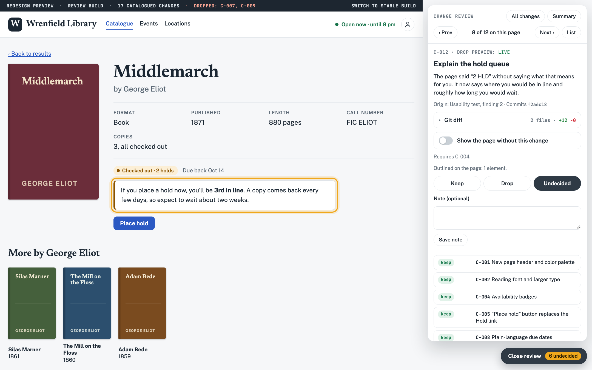
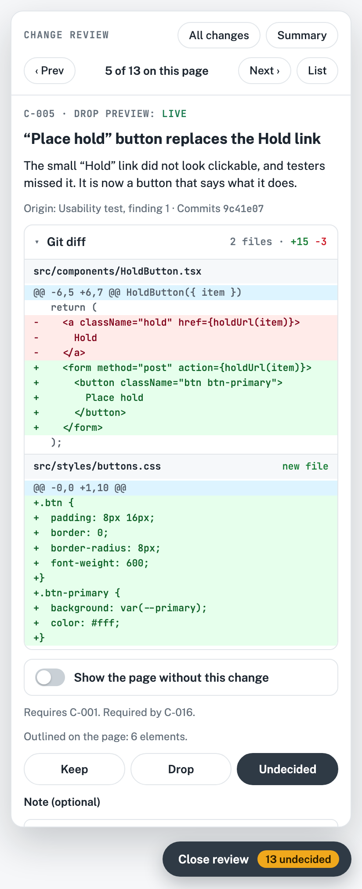
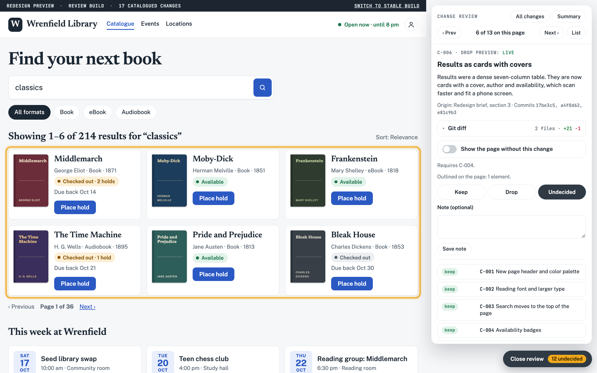
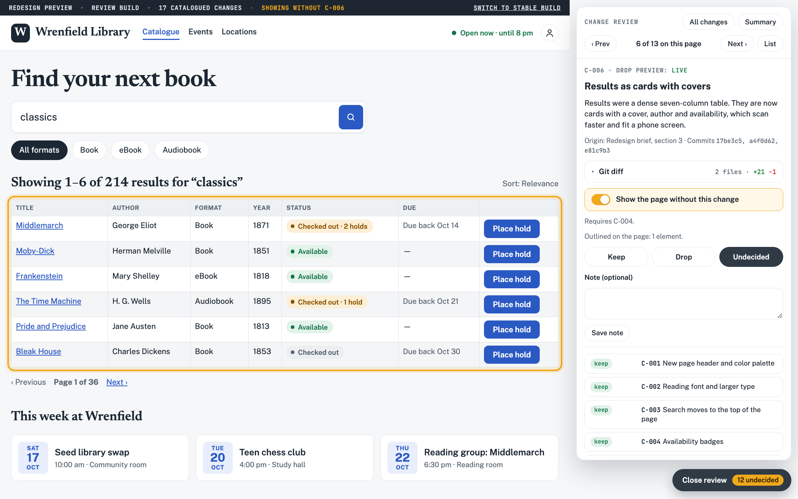
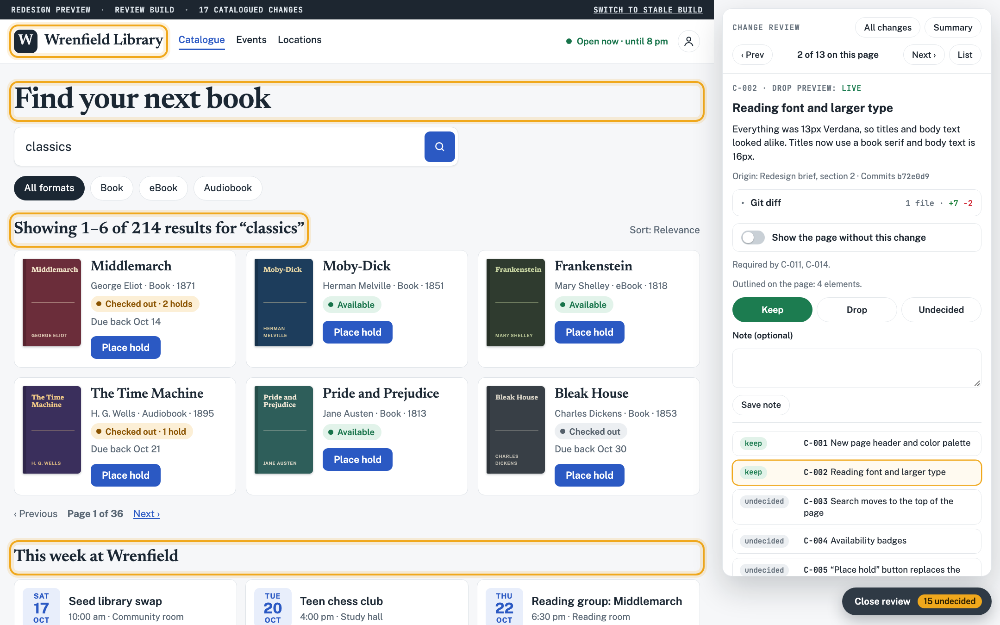
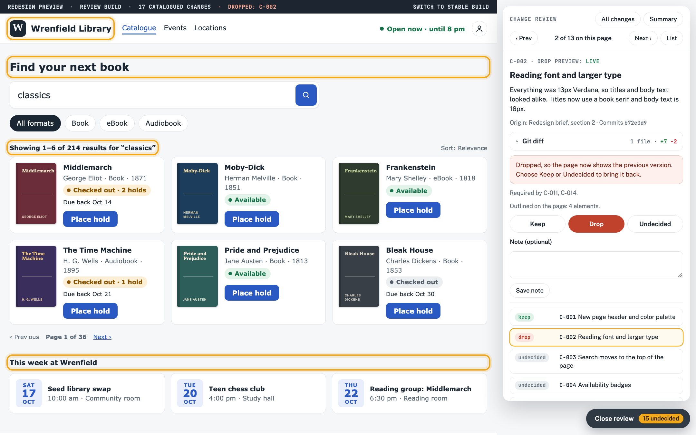
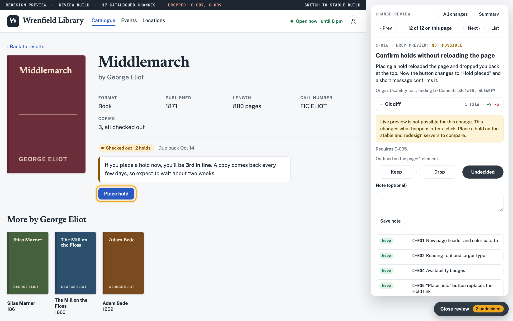
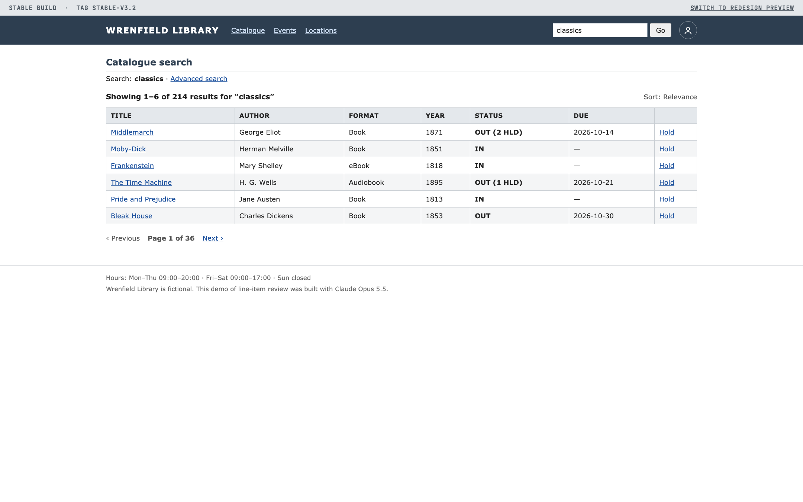
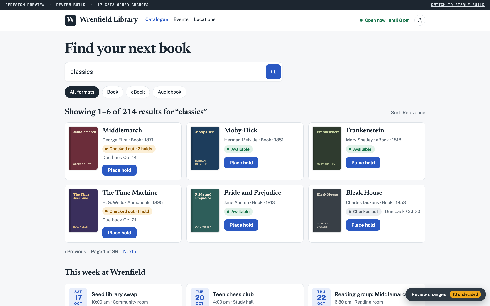
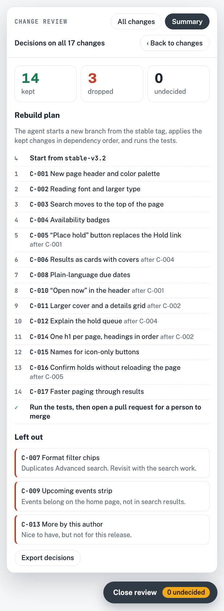

# Line-Item Review

A workflow for reviewing an AI agent's UI work one change at a time. Each change has a name and a reason, and you see it in the running app, where you keep or drop it. **[Try the demo site](https://pshankinclarke.github.io/line-item-review/demo/)**

> **Made with Claude Opus 5.5.** Anthropic's Claude Opus 5.5 created this write-up and built the demo site, its screenshots, the mock git diffs and the example catalogue, working from my notes and feedback. See [How this was made](#how-this-was-made).


**[Read the illustrated write-up](https://pshankinclarke.github.io/line-item-review/)**

The screenshots come from Wrenfield Library, a made-up library catalogue in [`docs/demo/`](docs/demo/index.html).

## The problem

Coding agents are as good as they are prolific at UI work. Ask for a redesign and you get back a branch with fifty or eighty changes: spacing, copy, layout, new components, removed ones, a reworked form.

Reviewing that branch leaves two bad options. You can accept or reject the whole thing, which throws away good work along with the bad. Or you can read the code diff, which is slow and still doesn't show you what each change looks like or why the agent made it.

I wanted a third option: see every change in the running app, understand it in plain language, and exercise line-item veto by deciding on each change separately.

## How it has held up

| App | Changes catalogued by the agent | Changes that could be previewed on the page |
| --- | ---: | ---: |
| Mapping web app | 84 | 76 |
| Workspace dashboard | 48 | 23 |

The first column counts the changes the agent catalogued for me to review. The second column counts how many of those could be previewed visually in the app. At that size, reviewing the whole branch at once isn’t realistic. With a catalogue, each decision is small.

## How it works

### 1. The agent keeps a change catalogue

Every change the agent makes gets an entry in one file, such as `review/changes.json`. Each entry has an ID, a title, a note on what changed and why, the pages and element it affects, the commits that make it up, and the other changes it depends on.

```json
{
  "id": "C-005",
  "title": "“Place hold” button replaces the Hold link",
  "what_why": "The small “Hold” link did not look clickable, and testers missed it. It is now a button that says what it does.",
  "pages": ["catalogue", "book"],
  "element": "[data-ch~='C-005']",
  "commits": ["9c41e07"],
  "depends_on": ["C-001"],
  "live_preview": true
}
```

The agent writes each entry as it works, so the reason is recorded when the decision is made. The demo's full catalogue is in [`examples/changes.example.json`](examples/changes.example.json).

### 2. A review tray inside the app

The preview build of the app gets a review tray. It's off by default and never ships to production. Open it on any page and it lists only the changes that touch that page. Click one and the app outlines the affected elements and shows the agent's explanation next to them.



The catalogue already lists each change's commits, so the card can also show their git diff. The plain-language reason and the code that implements it sit on the same card.

<p></p>

### 3. Keep or Drop, one change at a time

Each change is marked Keep, Drop or Undecided. Where it's feasible, a **Show without** switch puts the element back the way it was, in place, so you can compare before deciding. Changes that can't be previewed live say why. Decisions are saved on the server with notes, and they can be exported.

| C-006 on | C-006 switched off with “Show without” |
| --- | --- |
|  |  |

“Show without” is only a preview. Dropping a change takes it off the page for real, right away, so the preview build always shows the result of the decisions so far. Drop C-002, the font change, and the whole page goes back to 13px Verdana while the rest of the redesign stays:

| C-002 kept | C-002 dropped |
| --- | --- |
|  |  |

When a change can't be shown in place, the tray says why. C-016 changes what happens after a click, so the tray points to the two servers instead.



### 4. Stable and redesign, side by side

Two copies of the app run at the same time on separate local ports: the last stable version and the agent's redesign. With one on each monitor, you can click through the same flow in both. This covers the changes the tray can't preview live, and it shows the overall feel of the redesign, which no single line item does.

| Monitor 1: stable build | Monitor 2: redesign preview |
| --- | --- |
|  |  |

### 5. A clean rebuild with only the kept changes

Once every change has a decision, the agent doesn't edit the redesign branch. It starts a fresh branch from the stable tag and applies only the kept changes, in dependency order, with tests. Nothing merges until a person has reviewed the result and merged it.

<p></p>

## Trying it yourself

Start with the catalogue alone. Ask the agent to record every change as an entry with an ID, a plain-language reason and its commits. That one file already makes review faster. Add the tray, the side-by-side servers and the rebuild step as the volume of agent work grows.

To see the whole flow first, [open the demo site](https://pshankinclarke.github.io/line-item-review/demo/). It runs entirely in your browser, and your decisions stay there.

## What's in this repo

- [`docs/index.html`](docs/index.html): the illustrated write-up, served by GitHub Pages
- [`docs/demo/index.html`](docs/demo/index.html): the demo site, one HTML file with no build step
- [`docs/shots/`](docs/shots/): the screenshots used above
- [`examples/changes.example.json`](examples/changes.example.json): the demo's change catalogue

## How this was made

Everything in this repo was made with Claude Opus 5.5 in Claude Code.

- **From me:** the workflow itself, the numbers from my two apps (84 and 76 catalogued changes, 48 of them with live preview), and feedback during the build, such as showing the git diff on each change card and making dropped changes revert on the page.
- **From Claude Opus 5.5:** the write-up, the design of the page, the Wrenfield Library demo site and its review tray, the mock code diffs, the example catalogue, and the screenshots, which it took with headless Chrome. It also clicked through the demo in a browser to check that it works.

Wrenfield Library and everything in it are fictional. The initial commit is co-authored by Claude.
